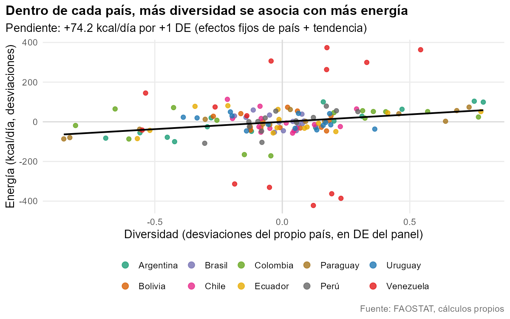
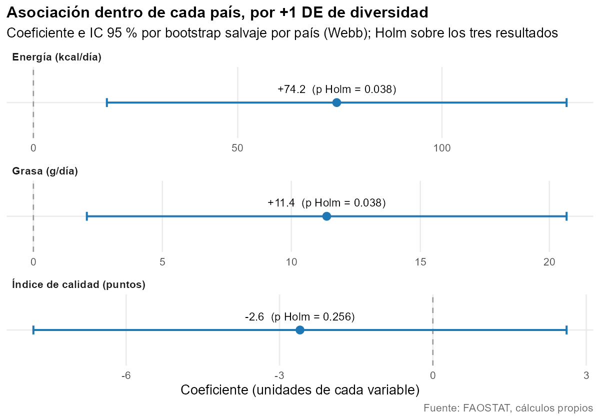
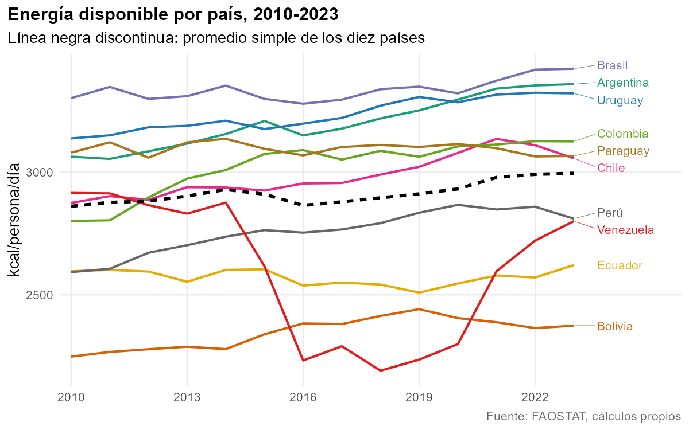
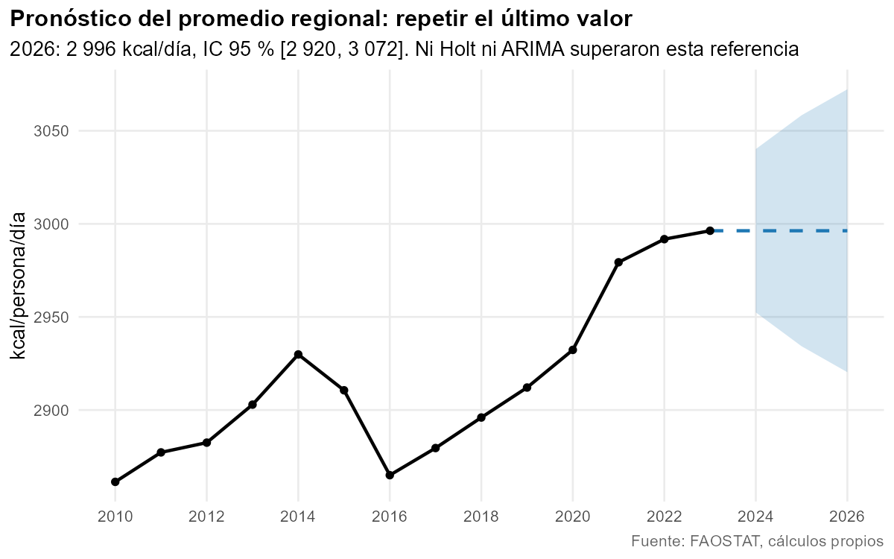

# Diversidad de la oferta alimentaria en Sudamérica (FAOSTAT, 2010-2023)

Un panel de 10 países sudamericanos para preguntarse si los años en que la oferta de alimentos es más diversa son también años con más energía, grasa y calidad. Dos informes en R Markdown, datos procesados y todo el código para reproducirlos.

[English version](README.en.md) · Informes en línea: <https://jps4l4.github.io/faostat-diversidad-alimentaria/> *(enlace provisional: se activará al publicar el repositorio)*

## La pregunta

> Dentro de cada país, ¿los años de oferta alimentaria más diversa son también años con más energía, más grasa y mejor calidad de la oferta?

Importa porque "más variedad" suele leerse como "mejor dieta". Aquí se pone a prueba con datos de disponibilidad, y se mide con cuidado cuánto aguanta la respuesta.

## Los datos

- **Fuente:** FAOSTAT (FAO). Dominio probable: Balances Alimentarios (2010-), *Food Balances*. Falta confirmar el dominio, los elementos y las unidades.
- **Países (10):** Argentina, Bolivia, Brasil, Chile, Colombia, Ecuador, Paraguay, Perú, Uruguay y Venezuela.
- **Panel:** 2010-2023, 140 filas país-año (equilibrado).
- **Indicadores por país:** ventana 2019-2023.
- **Estado:** los datos procesados están en [`data/processed/`](data/processed/). Los **datos crudos están pendientes** de añadirse; ver [`data/raw/README.md`](data/raw/README.md).

## Método

**1. Descriptivo** ([informe](https://jps4l4.github.io/faostat-diversidad-alimentaria/01_descriptivo.html)). Revisión de calidad de los datos, tendencias por país, prueba de Mann-Kendall, correlaciones, PCA y conglomerados. Concluye qué etapa conviene después.

**2. Diagnóstico** ([informe](https://jps4l4.github.io/faostat-diversidad-alimentaria/02_diagnostico.html)).
- Modelos de panel de efectos fijos y aleatorios (con tendencia común), y prueba de Hausman.
- Con solo 10 países, la inferencia usual no es fiable. Se comparan errores agrupados por país, Driscoll-Kraay y bootstrap salvaje por país con pesos de Webb, con corrección de Holm por tres resultados.
- Robustez: efectos de año, primeras diferencias, diversidad rezagada, quitar un país a la vez, quitar los años de crisis de Venezuela.
- Pronóstico breve de la energía: ingenuo contra Holt y ARIMA, con validación estrictamente temporal (partición fija y orígenes móviles).

## Resultados principales

Son **asociaciones**, no efectos causales.

- **Dentro de cada país**, +1 DE de diversidad se asocia con **+74,2 kcal/persona/día** (+2,5 %; p bootstrap Webb = 0,012; Holm = 0,038) y **+11,4 g de grasa/día** (+12 %; Holm = 0,038; se mantiene en las 6 verificaciones de robustez).
- **Calidad de la oferta:** no hay asociación.
- **Es frágil.** Con efectos de año ninguna asociación sobrevive a Holm. En primeras diferencias el efecto sobre la energía desaparece (-14,5 kcal; p = 0,53), mientras que el de la grasa se mantiene.
- **Entre países (n = 10)** ninguna asociación sobrevive a Holm.
- **Hausman** no rechaza efectos aleatorios, con poca potencia; se conservan los efectos fijos.
- **Pronóstico:** repetir el último valor supera a Holt y ARIMA (MAE en orígenes móviles 35,7 kcal/día; MAPE 1,27 %). Para el promedio regional en 2026: ≈ 2 996 kcal/día [2 920 – 3 072].





| | |
|---|---|
|  |  |

## Estructura

```
analysis/        01_descriptivo.Rmd, 02_diagnostico.Rmd
data/processed/  3 CSV (panel país-año, indicadores por país, PCA y clústeres)
data/raw/        pendiente (ver su README)
docs/            informes HTML, página de inicio y figuras (GitHub Pages)
scripts/         render.R (informes) y figures.R (figuras)
```

## Cómo reproducirlo

Requiere R 4.6 (probado con 4.6.1) y [Pandoc](https://pandoc.org/) (viene con RStudio).

Paquetes: `tidyverse`, `janitor`, `plm`, `sandwich`, `lmtest`, `knitr`, `rmarkdown`, `DT`, `corrplot`, `factoextra`, `cluster`, `ggrepel`, `moments`; `ragg` es opcional.

```
Rscript scripts/render.R     # genera docs/01_descriptivo.html y docs/02_diagnostico.html
Rscript scripts/figures.R    # regenera docs/img/*.png
```

Ejecútalos desde la raíz del repositorio. Los informes toman la fecha del día en que se renderizan.

## Limitaciones

- Diez países y 14 años: poca potencia, y los resultados dependen de la inferencia elegida.
- Es disponibilidad de alimentos (balances), no consumo.
- El índice de diversidad se calcula con la misma oferta que determina energía y grasa, así que la relación puede ser en parte mecánica.
- El índice de calidad es parcial (frutas y hortalizas, y proporción de energía de grasa).
- Los datos crudos aún no están en el repositorio, ni el script que los convierte en los CSV procesados.

## Autores

Juan Salazar y Luz Ríos. Proyecto universitario (ITM).

## Datos y licencia

FAO. FAOSTAT. Balances Alimentarios (2010-) / *Food Balances (2010-)*. Roma. *(dominio por confirmar)*. <https://www.fao.org/faostat/>

Los datos de FAOSTAT se usan según los términos de uso de la FAO.

Licencia: pendiente.
